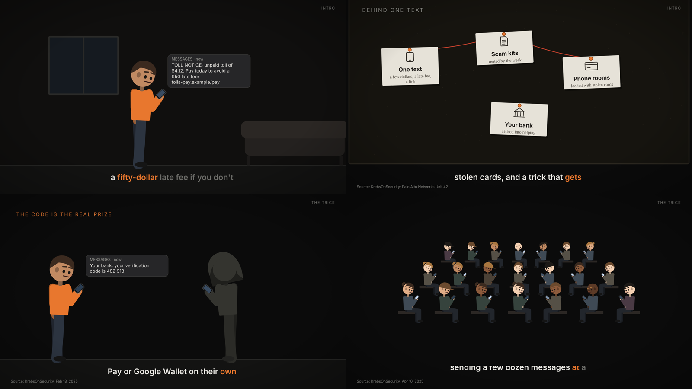

# motion-studio

A Claude Code skill for making short motion-graphics films in code: article trailers, explainers, product launch films, inbox digests. Claude writes the film as one HTML file where every frame is a function of time, renders it in headless Chrome, cuts licensed music to the beat, places recorded sound effects on their peaks, and checks the result before you see it.


*An excerpt from* ***Walk to Digest*** *(35 s, 4:5), made with this skill from the Substack essay ["Write More Without Spending More Time on Your Computer"](https://brewblocks.substack.com/p/write-more-without-spending-more). [Watch the full film with sound](docs/walk-to-digest-v3.mp4). Soundtrack: "Cat Walk" and sound effects from Mixkit (Mixkit Free License), impacts from Kenney (CC0).*

What makes it more than "Claude, make me a video":

- **A thesis contract.** Before anything moves, the storyboard states the source's thesis and argument chain. Every edit and every reviewer note answers to it, because the easiest way to ruin a film is a series of reasonable cuts that quietly remove its point.
- **A blind read before shipping.** A fresh agent that has never seen the source looks at one still per bar plus the on-screen text and says what the film argues. If that doesn't match the contract, the film isn't done.
- **Music first, on the grid.** Tracks are measured (tempo, downbeat, a bar-by-bar loudness map showing the build, the drop and the breakdown), and the film is cut to the song's bars rather than the other way round. The downbeat is corrected automatically from where the song's sections change.
- **A live preview you can annotate.** Scrub or play the film with its soundtrack in the browser, pin notes at the playhead ("slow this push", "hard cut here"), and Claude reads them, fixes the film and marks them done while the page hot-reloads.
- **Verification.** Every final is checked for format, fast start, a clean decode, colour range, loudness (−14 LUFS), and single-frame glitches.
- **Variety.** A film ledger records each film's signature move, track and sound palette so the next one doesn't repeat them.

## Long narrated explainers



*Stills from a test cut built from [`examples/longform/script.json`](examples/longform/script.json).*

`scripts/longform.py` makes 5–20 minute 16:9 videos for YouTube from a script and one voice clip per segment (any TTS, or your own read):

- **Beats land on words.** `align` times every spoken word offline (PocketSphinx forced alignment; no paid voice API). Anything in a scene can say `"at": "late fee"` and it happens as the narrator says it.
- **People, not slides.** `figure.js` draws flat, rigged characters with 17 poses, faces, a walk cycle and idle breathing. `stage` scenes act a line out (a phone buzzes, a notification appears, someone flinches); anonymous actors are silhouettes. `board` pins evidence cards up with red string and a stamp; `crowd` pulls back from one person to a room of them.
- **Music by mood.** Each chapter names a mood (tension, mystery, serious, calm, warm, drive, uplift); `music` measures the library and picks a track per run of chapters, crossfades on chapter lines and back-times the last track to end with the film. It says so when nothing in the library fits.
- **A critic before you watch.** `check` measures text-only stretches, holds where nothing changes, whether every word cue produced a visible change, and one-frame flashes. A fresh-agent critic loop works from those numbers (`references/critic.md`).
- **Captions and upload.** `timeline` writes a VTT caption track from the word times; `scripts/youtube.py` uploads (private by default), sets the thumbnail and adds the captions.

## Install

```bash
claude plugin marketplace add wcfcarolina13/motion-studio
claude plugin install motion-studio@motion-studio
```

Requirements: Python 3.10+ with `pip install playwright numpy scipy` (plus `pocketsphinx` for long-form word timing), Google Chrome (rendering uses the installed Chrome through Playwright, so there's no browser download; set `MS_CHROMIUM` to a Chromium binary on machines without Chrome), and ffmpeg (`brew install ffmpeg`). The Codex CLI is optional, for a second-model reviewer.

Then ask for a film in plain words, e.g. *"Make a 30-second 4:5 video of this article: https://…"*, and the skill takes it from there.

## Configure (optional)

Copy `examples/motion-studio.json` to `~/.motion-studio.json` to choose where films, the audio library and the ledger live (defaults are under `~/motion-studio/`). Copy `examples/house.md` to the `house` path and fill it in: your palette, your standing rules, which models play reviewer. The skill reads it before every film, so nothing personal has to live in the skill itself.

## What's inside

```
plugin/skills/motion-studio/
  SKILL.md                    the workflow
  scripts/studio.py           the CLI: new, stills, draft, final, verify, serve, notes, mix, fetch, measure, blindpack…
  scripts/kit.js              the engine: springs, keyframes, camera, mask captions, clip helpers (copied into each film)
  scripts/figure.js           rigged SVG people: poses, faces, walk cycle, idle motion, crowds
  scripts/longform.py         long narrated films: align, timeline, music by mood, render, mix, check
  scripts/align.py            offline word timestamps for narration you already have
  scripts/youtube.py          private-by-default YouTube upload, thumbnail, captions (standard library only)
  scripts/audio.py            the audio library, track measurement, and the Mix every film's sound.py uses
  scripts/preview.*           the live preview server and page
  references/                 story, motion vocabulary, sound, review checklists, the review panel, formats, long-form, figures, critic
  assets/templates/           film.html, longform.html, storyboard.md, sound.py, ledger.md
```

Formats: 4:5 (default), 9:16 and 16:9, each with its own caption band.

## Audio licences

No audio ships with this repo. `studio.py fetch` downloads from [Mixkit](https://mixkit.co) (the Free License covers social, YouTube and ads, but not broadcast, games or music-only remixes; sound effects are free for any video) and [Kenney](https://kenney.nl) (CC0). Every downloaded asset is recorded in the library's `catalog.json` with its source and licence.

## Credits

Built from four X threads and what three films taught us:

- [@rexan_wong](https://x.com/rexan_wong/status/2103707054108299437): the workflow (reference styles, a code renderer, real components, storyboard variants, stills first, director notes).
- [@shiri_shh](https://x.com/shiri_shh/status/2103521939134550246): [latent-spaces/brag](https://github.com/latent-spaces/brag), a teaser-with-sound-design skill.
- [@anthonyriera](https://x.com/anthonyriera/status/2103801891528573089): [Rieranthony/product-film-skill](https://github.com/Rieranthony/product-film-skill). Its `beats.py` is vendored here under its MIT license (see `scripts/LICENSE-product-film.txt`).
- [@twoclipping](https://x.com/twoclipping/status/2103835273813496100): the pure-code method (one HTML file, `seek(t)`, Playwright + ffmpeg, subframe motion blur).

Version 1.1 (long-form) took ideas, not code, from repos shared on X in October 2026, all MIT unless noted:

- [cclank/lanshu-create-ai-presenter-video](https://github.com/cclank/lanshu-create-ai-presenter-video) (@LufzzLiz): every beat timed from the narration's words, procedural SVG characters with cue/move/emote, the casefile evidence board, stillness checks.
- [echris6/motion-video-kit](https://github.com/echris6/motion-video-kit): the fresh-agent critic and verification round, frozen-time measurement, back-timing music to the end.
- [Barty-Bart/motion-graphics](https://github.com/Barty-Bart/motion-graphics): narration-to-B-roll density and "one change per spoken beat".
- [AbubakrChan/product-launch-motion](https://github.com/AbubakrChan/product-launch-motion): word-locked cue rules (land 0.02–0.06 s before the word).
- [howseen-ai/claude-motion-design](https://github.com/howseen-ai/claude-motion-design): the one-frame flash detector and caption timing rules.
- [charlie947/motion-graphics-skills](https://github.com/charlie947/motion-graphics-skills): a critic that reports only what it observes.
- [LottieFiles/motion-design-skill](https://github.com/LottieFiles/motion-design-skill), [haidrrrry/claude-remotion-skill](https://github.com/haidrrrry/claude-remotion-skill), [t3knobox/klik-anim-skill-creation](https://github.com/t3knobox/klik-anim-skill-creation) (no licence: ideas only): pacing and emotion-to-motion rules.

Left out on purpose: generated or synthesized music and sound (breaks the licensed-recording rule), paid avatar and voice APIs, and Open Edit (its installer adds an auto-updating session hook; X attached a warning note).

## License

MIT (see `LICENSE`). The vendored `beats.py` keeps its own MIT notice.
