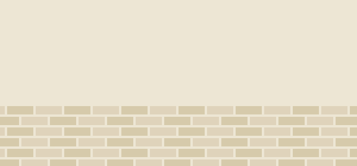

# Sprite stacks: pixel props that turn

A sprite stack is a strip of flat top-down layers, drawn bottom to top, each rotated by the same angle, squashed for the camera's pitch and lifted one art pixel. The layers read as a solid object that turns in crisp pixels, with no 3D engine and no drawing per angle. Use it for props in a pixel-art film: a bin, a stall, a van, a block of shops, a tree. It fits a canvas-drawn pixel look; it does nothing for vector, marker or painted looks.



*`examples/stack/`: two props drawn in code (`draw_props.py`), carved with `stack.py`, animated with `stack.js`. The 10 s 1080p render passed `final` (no single-frame pops) and gave identical pixels when 8 moments were rendered again in the same page and in a fresh browser.*

## Make one

1. **Draw four views** in one row, on a transparent or flat background, with a clear gap between them:
   - **TOP**: looking straight down, the front at the bottom.
   - **SIDE**: seen from the object's right, so the front points left.
   - **FRONT**: seen standing in front of it.
   - **BACK**: seen standing behind it.

   The sizes must agree in art pixels: TOP width = FRONT width = BACK width, TOP height = SIDE width, SIDE height = FRONT height = BACK height. That height is the layer count. Draw them in code (one array cell per art pixel, as `examples/stack/draw_props.py` does) or with an image model; a generated sheet must be cleaned to hard, flat pixels first, or it carves mush.
2. **Carve**: `stack.py carve views.png props/bin.png --film <film>`. It finds the enlargement (each art pixel drawn as an N x N block), checks the sizes, writes the strip, `bin.json` (layer count, layer size, warnings) and `bin-check.png`, and copies `stack.js` into the film.
3. **Look at the check sheet** before using the strip: the four views as read, five angles and an exploded view. A wrong colour on a wall or a wrong-way label means a view is mirrored or in the wrong slot.
4. **Draw it in the film**, on a `<canvas>` under the SVG:

```js
const bin = Stack.load("props/bin.png", 22);          // the count from bin.json
window.STUDIO.ready = Stack.ready();                  // render.py waits for the strips to decode
K.run(t => {
  ctx.clearRect(0, 0, K.W, K.H);
  Stack.draw(ctx, bin, 680, 760, { turn: t * 0.8, scale: 8, shadow: { opacity: 0.22, dx: 3, dy: 2 },
                                   grow: K.eio(K.prog(t, 0.1, 1.3)) });
});
```

`(x, y)` is where the stack stands. Options are listed at the top of `stack.js`: `turn` (0 shows the front), `pitch` (0.75), `spacing` (1; 2 to 3 for an exploded view), `scale` (whole numbers only), `outline`, `shadow`, `grow` (builds the stack from the ground up), `alpha`. `Stack.box()` gives the screen box, for layout and for keeping captions and cards clear.

## Rules that keep it clean

- **Whole-number scale, one rounding.** Layers are sampled into a buffer of one art pixel per pixel and blown up by a whole number; the stack's screen position is rounded once, at the end. Rounding motion to art-pixel steps makes slow drifts jump.
- **Rotate about the true centre**, `((w - 1) / 2, (h - 1) / 2)`. Rounding the centre down shifts even-sized layers half a pixel, and the stack wobbles every quarter turn.
- **One outline around the whole stack**, never one per layer: per-layer rings show as seams on the walls.
- **Grow in, don't fade in.** A stack fading in mid-air looks flat. `grow` raises each layer into place over the four below it, so the top settles without a one-frame jump.
- **Scale for 1080p**: about 6 to 8 screen pixels per art pixel for props 14 to 30 art pixels wide. Small sprites blown up further step visibly as they turn; draw more detail instead.
- **One stack, one draw.** Never interleave the layers of two stacks; sort whole stacks by their ground point, back to front.

## What the carve can't do

- A voxel is kept only where all four views cover it. A hollow no view can see (a truck bed, an arch seen end-on) fills in solid.
- Something that sticks out of one wall (a sign, a mirror) carves a ledge along that whole wall. Paint small protrusions flat, or span the whole wall as the awning does.
- There is no fifth view: the left wall copies SIDE. Put asymmetry in TOP, FRONT and BACK.
- A part one art pixel thin (a pole, a wire, a handle) falls between samples at some angles and flickers. `carve` warns with the layers; draw it 2 pixels wide.
- Corner voxels sit on two walls and take the side wall's colour.

## Cost

Every frame of a stack is drawn in software. On the M2 Pro the 26 x 16 x 28 stand took 0.28 ms a frame while turning; frames are cached per option set, so a stack that holds still costs one blit (0.003 ms). Dozens of turning stacks a frame add up: bake background props that don't turn into one canvas once.

Credit: the method and the four-view workflow come from Daniel White's [danielwh2/sprite-stacking](https://github.com/danielwh2/sprite-stacking) (MIT), shared on X on 2026-11-22. `stack.py` and `stack.js` are written fresh for this engine; no code is copied.
